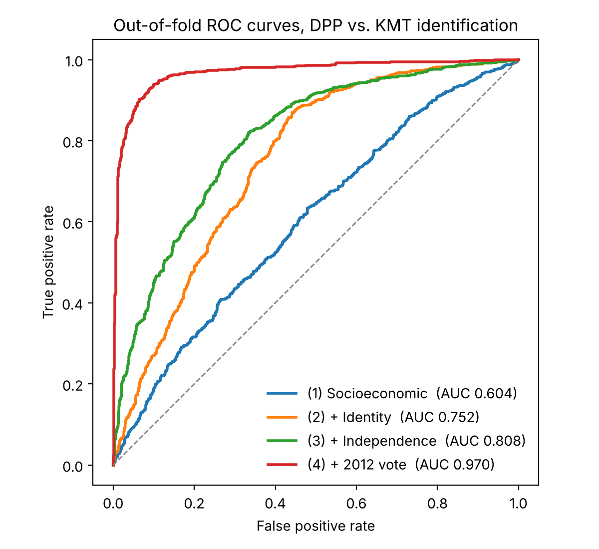

# Identity versus Class in the Taiwanese Electorate

Does national self-identification or socioeconomic position better explain which of Taiwan's two main parties a voter supports? Using three waves (2012 to 2014) of the Taiwan Social Change Survey, this project compares nested models of DPP versus KMT identification among 1,705 partisans.

**Main result.** Socioeconomic and demographic variables barely separate DPP from KMT supporters (out-of-sample AUC 0.60). Adding national identity raises the AUC to 0.75, and adding the respondent's stance on independence raises it to 0.81. Identifying as "Taiwanese" rather than "both Taiwanese and Chinese" is associated with a 42 percentage point higher probability of DPP identification, holding class and demographics fixed. Past presidential vote then pushes the AUC to 0.97, and flexible machine learning models (random forest, gradient boosting, XGBoost, CatBoost) do no better than a logit with the same covariates.

| Covariates | McFadden pseudo R² | Out-of-sample AUC (5-fold CV) |
| --- | ---: | ---: |
| (1) Socioeconomic and demographic | 0.035 | 0.604 |
| (2) + National identity | 0.177 | 0.752 |
| (3) + Independence stance | 0.241 | 0.808 |
| (4) + 2012 presidential vote | 0.713 | 0.970 |



## Reproducing the results

The code needs Python 3.14 and [uv](https://docs.astral.sh/uv/). From the repository root:

```bash
uv sync                          # create the environment from uv.lock
uv run python run_all.py         # rebuild every table and figure (under a minute on 4 cores)
uv run python run_all.py --fast  # quicker check with fewer tuning iterations
uv run pytest                    # tests for the recoding rules and the sample
```

Each step can also be run on its own, for example `uv run python -m src.covariate_blocks`. All randomness (CV folds, train/test split, hyperparameter search) is seeded in `src/config.py`.

## Repository layout

| Path | What it does |
| --- | --- |
| `src/recode.py` | Every coding decision, written as ordered (pattern, label) rules that map the Chinese answer labels of each wave to common English categories |
| `src/build_sample.py` | Step 1: loads the three waves, harmonizes them and writes the pooled analysis sample plus a sample construction log |
| `src/covariate_blocks.py` | Step 2: four nested logits with average marginal effects, robust standard errors and cross-validated AUC; writes the main table and the ROC figure |
| `src/ml_models.py` | Step 3: logit versus tuned tree ensembles on a held-out test set, plus grouped permutation importance |
| `src/config.py` | Paths, seeds and constants |
| `run_all.py` | Runs steps 1 to 3 in order |
| `tests/` | Unit tests for the recoding rules and checks on the constructed sample |
| `Data/` | Survey extracts for 2012, 2013 and 2014 (converted from Stata to CSV) |
| `output/tables/` | `covariate_blocks.tex` / `.md` (main table), `model_comparison.tex` / `.md` / `.csv`, `permutation_importance.csv` |
| `output/figures/` | `roc_covariate_blocks.png`, `permutation_importance.png` |
| `output/logs/` | `sample_construction.md`: respondents kept at each step, by wave |
| `main.ipynb`, `index.html` | The original exploratory notebook and its rendered version ([view online](https://faustourrutiareyes.github.io/taiwanese-identification-research/)) |

## Data

The data come from the Taiwan Social Change Survey, run by the Center for Survey Research at Academia Sinica. The 2012, 2013 and 2014 waves are used because they all ask respondents whether they consider themselves Taiwanese, Chinese, or both. The original Stata files were converted to CSV by a classmate; everything else in this repository is my own work.

## Coding decisions worth knowing

- **Outcome.** Respondents who identify with or lean toward the DPP (民進黨, 泛綠) are coded 1 and those who identify with or lean toward the KMT (國民黨, 泛藍) are coded 0. Everyone else (no party, small parties, refusals) is outside the estimation sample. The 2012 questionnaire has no "lean" option, so all models include wave fixed effects.
- **Independence stance.** The six-point independence/unification scale is collapsed to direction: independence (now or eventually), unification (now or eventually), and status quo (indefinitely, or "decide later", an option only 2014 offers).
- **2008 presidential vote is not used.** In 2014 the variable that holds the 2008 vote in other waves records whether the respondent took a referendum ballot instead, so it cannot be compared across waves. The 2012 vote is asked consistently and is used instead.
- **Religion is not used.** It was not asked in 2013 (99.8% missing).
- **Income.** Bracketed monthly income is converted to bracket midpoints in NT$10,000, with an indicator for refusals and "don't know" (19% of partisans for household income).
- **Weights.** Estimates are unweighted.

## Interpretation and limitations

The models describe and predict; they do not identify causal effects. Past vote is best read as a summary of earlier partisanship (and is itself shaped by identity), so model (4) shows how much of identity's association with party runs through prior behavior rather than an independent effect of voting. The sample covers 2012 to 2014 only, so it says nothing about later shifts such as the 2016 DPP victory.

## Differences from the original notebook

`src/` is a cleaned, scripted version of `main.ipynb`. Rebuilding it fixed several issues, so its numbers differ from the notebook's:

- The notebook's independence recode mapped "status quo, then independence" and "status quo, then unification" to "status quo"; they are now coded by direction.
- The notebook's gender variable became missing for 2012 because the category list used different labels; it is now coded for all waves.
- The notebook used the 2014 referendum-ballot question as if it were the 2008 vote, and included township dummies; both are dropped.
- Model comparisons now use a stratified split, AUC alongside accuracy, and tuning on the training set only. Held-out accuracy is about 92% for both the logit and the tree ensembles (the notebook reported 94.7% for XGBoost).
